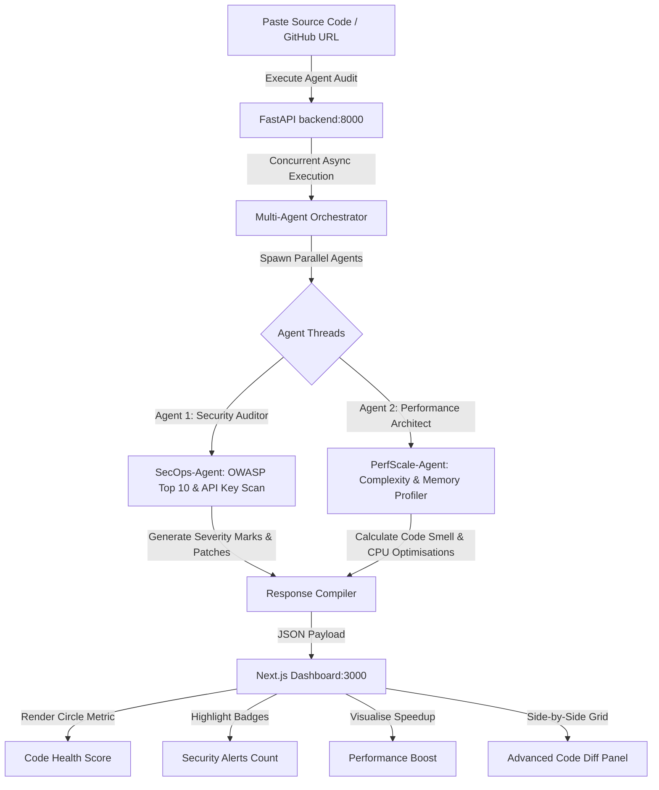

# 🚀 DevPulse AI: Autonomous Multi-Agent Code Reviewer & Security Auditor

DevPulse AI is a production-ready, autonomous code auditing platform that intercepts vulnerabilities and performance bottlenecks before they hit production. Using parallel agentic reasoning powered by **Google Gemini 1.5 Pro** and **LangChain**, it acts as a digital dual-engine security auditor and systems performance architect.

Built for the live 24-hour hackathon, DevPulse AI provides developers with instant, high-fidelity security patches and low-latency refactored code blocks, visualised on a stunning glassmorphic dashboard.

---

## 🎨 System Flow Diagram



---

## 🌟 5 Cutting-Edge Features

### 1. Dual-Agent Concurrent Review Engine
Instead of running a single prompt which struggles with context-switching, DevPulse AI spawns two specialized, autonomous agents that process the code in parallel:
* **SecOps-Agent** (Senior Cyber Security Auditor) searches for SQL Injection, XSS, SSRF, and hardcoded API keys.
* **PerfScale-Agent** (Principal Software Architect) reviews execution bottlenecks, memory leaks, and clean code principles.

### 2. Interactive Code Health Scoring & Diagnostic Telemetry
Calculates a real-time **Code Health Score** dynamically rendered in a circular SVG metric, counts security alerts, and estimates performance speedup percentages. The live agent log terminal shows the step-by-step progress of the agents.

### 3. Advanced Side-by-Side Code Diff Panel
Displays the original vulnerable code wrapped in a red border next to the optimized, secured code wrapped in an emerald-green border, complete with an interactive "Copy Fixed Code" clipboard utility.

### 4. Language Versatility
Supports auditing for multiple programming languages including **Python**, **JavaScript**, **C++**, and **Java**, customizing the system prompts and response formatting based on the target language.

### 5. High-Fidelity Local Sandbox Fallback
If the Google Gemini API keys are not configured or if there is no internet connection, the system automatically detects the environment and switches to a high-fidelity local sandbox simulation. It serves realistic reports and code refactoring for demonstration queries, ensuring that the hackathon pitch is 100% stable and operational.

---

## ⚙️ How to Install & Run Locally

### 1. Prerequisites
* **Python**: Version 3.10 or higher
* **Node.js**: Version 18.x or higher

### 2. Clone and Setup Environment

#### Backend Setup:
1. Navigate to the backend directory:
   ```bash
   cd backend
   ```
2. Create and activate a virtual environment:
   ```bash
   python3 -m venv venv
   source venv/bin/activate
   ```
3. Install dependencies:
   ```bash
   pip install -r requirements.txt
   ```
4. Configure Gemini API key (Optional):
   ```bash
   export GEMINI_API_KEY="your-gemini-key"
   ```
   *(Note: If no API key is set, the platform will gracefully fall back to local high-fidelity sandbox mode).*

#### Frontend Setup:
1. Navigate to the frontend directory:
   ```bash
   cd frontend
   ```
2. Install npm packages:
   ```bash
   npm install
   ```

---

### 3. Start DevPulse AI
From the root of the project, launch the backend server (FastAPI) and the frontend server (Next.js) concurrently using the startup script:
```bash
./run.sh
```

* **Local Control Panel UI:** `http://localhost:3000`
* **FastAPI Server Endpoint:** `http://localhost:8000`

---

## 🔮 Demonstration Snippet
To test the agents, paste the following vulnerable code in the sandbox editor and click **Analyze Code with Multi-Agents**:

```python
def login_user(username, password):
    # CRITICAL SECURITY FLAW & BAD PERFORMANCE
    import sqlite3
    conn = sqlite3.connect('users.db')
    cursor = conn.cursor()
    query = f"SELECT * FROM accounts WHERE user='{username}' AND pass='{password}'"
    cursor.execute(query)
    return cursor.fetchall()
```

DevPulse AI will immediately catch:
1. **Security Alert (SQLi)**: The raw query construction via f-strings.
2. **Performance Bottleneck (Disk I/O)**: The creation of a database connection inside the function call.
3. **Refactored Solution**: Parameterized input bindings and connection pool reuse.
