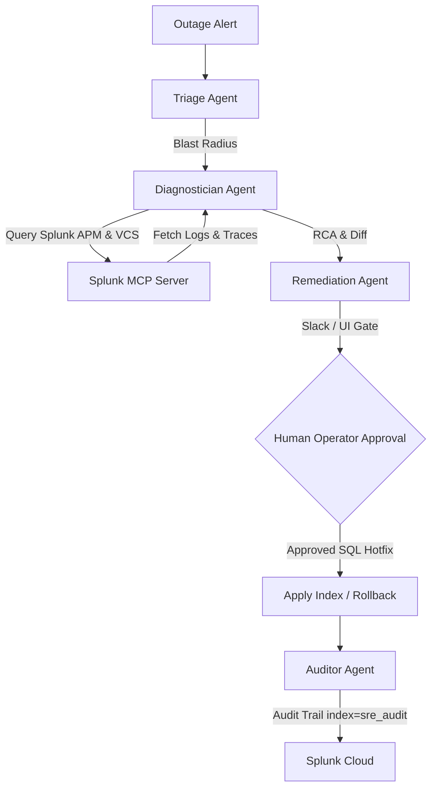

# 🚀 Auto-SRE: Autonomous Multi-Agent Incident Response & Self-Healing

Auto-SRE is an enterprise-grade, autonomous Site Reliability Engineering (SRE) assistant that automatically triages, diagnoses, and remediates application degradations in minutes instead of hours. Built for the **Splunk Agentic Ops Hackathon 2026**.

---

## ⚡ Tech Stack (Short & Punchy)

*   **Orchestration:** LangGraph (Multi-agent state machine control)
*   **Data & Observability:** Splunk MCP (Model Context Protocol), Splunk APM
*   **LLMs:** GPT-4o / Claude 3.5 Sonnet / Gemini 1.5 Pro (via Splunk MCP)
*   **Infrastructure:** Kubernetes, AWS, GitHub Actions

---

## 🎨 The "Wow" Factor (Visuals & Demos)

### ⏱️ Side-by-Side Comparison (Manual vs. Auto-SRE)

| Step | Manual Investigation (45 - 60 Mins) | Auto-SRE Investigation (2 Mins) |
| :--- | :--- | :--- |
| **Triage** | Scroll Slack alerts, find the target microservice, set up a war room. | **Triage Agent** intercepts the alert, maps the service and symptoms in 5 seconds. |
| **APM / Logs Scan** | Run multiple manual queries on Splunk to check CPU, APM traces, and DB calls. | **Diagnostician Agent** calls Splunk MCP tools to run secure SPL queries automatically. |
| **VCS Correlation** | Scroll through git history, contact engineers to find recent config changes. | Agent inspects Splunk VCS logs, detects the faulty commit, and outputs a visual **Git Diff**. |
| **Mitigation** | Manually execute Kubernetes rollbacks or apply DDL index scripts. | **Remediation Agent** proposes recovery paths (e.g. safe SQL Hotfix vs. Git Rollback) instantly. |

### 💬 ChatOps Human-in-the-Loop Approval
Auto-SRE integrates directly into engineering ChatOps workflows. The agent dispatches alert details to a Slack channel with interactive buttons, allowing engineers to authorize fixes directly from Slack.

*(Include the `ChatOps Slack Alert` screenshot here showing the interactive approval buttons)*

---

## 🔄 How It Works



---

## 🚀 Getting Started

### 1. Run the Startup Script
From the root of the project, launch the backend (FastAPI) and frontend (Next.js) concurrently:
```bash
./run.sh
```

*   **Local Dashboard UI:** `http://localhost:3000`
*   **API Server Endpoint:** `http://localhost:8000`

### 2. Simulate Outages
Open the dashboard at `http://localhost:3000`:
*   **Scenario A:** Payment-Service Checkout Latency (Resolves by executing DDL Index Hotfix).
*   **Scenario B:** Auth-Service Session Errors (Resolves by Reverting Config Commit).

---

## 🔮 Future Roadmap (The Vision)

> **Future:** Integrating Predictive SRE to fix issues even **BEFORE** the alert triggers (using Splunk's predictive analytics and forecasting metrics).
