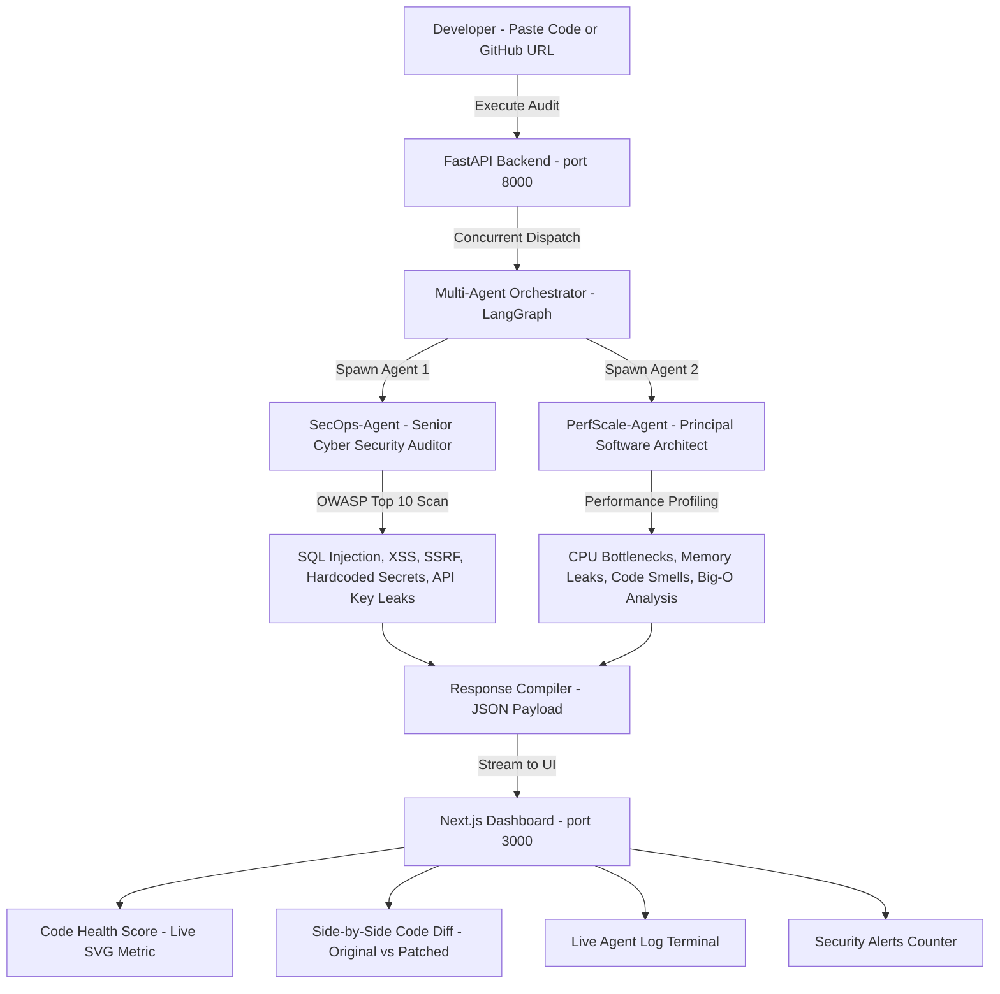

<div align="center">

# 🔐⚡ DevPulse AI

### Real-time AI code security + performance audit in under 30 seconds

[](https://www.python.org/)
[](https://nextjs.org/)
[](https://ai.google.dev/)
[](https://langchain-ai.github.io/langgraph/)
[](https://opensource.org/licenses/MIT)
[](https://devpost.com/)

**DevPulse AI** is a production-ready, autonomous dual-agent code auditing platform that intercepts vulnerabilities and performance bottlenecks before they hit production. Powered by **Google Gemini 1.5 Pro** and **LangGraph**, it spawns **SecOps-Agent** and **PerfScale-Agent** concurrently — delivering OWASP security patches and performance refactors in a single, stunning glassmorphic dashboard.

> Built for a live 24-hour hackathon — fully functional, fully autonomous, fully impressive.

</div>

---

## Architecture — Dual-Agent Flow



---

## 5 Cutting-Edge Features

### 1. Dual-Agent Concurrent Review Engine
Instead of running a single prompt that struggles with context-switching, DevPulse AI spawns **two specialized autonomous agents** that process code in parallel — zero waiting, double the intelligence:
- **SecOps-Agent** — Hunts SQL Injection, XSS, SSRF, hardcoded API keys, and all OWASP Top 10 vulnerabilities
- **PerfScale-Agent** — Diagnoses execution bottlenecks, memory leaks, and Big-O complexity issues

### 2. Live Code Health Score & Diagnostic Telemetry
A dynamically rendered **circular SVG Code Health Score** (0–100) gives you an instant at-a-glance signal. The live agent log terminal streams step-by-step agent reasoning in real time — like watching two senior engineers debug your code simultaneously.

### 3. OWASP Top 10 Security Scanner
Deep-scans code against the **OWASP Top 10** vulnerability checklist including injection attacks, broken auth, sensitive data exposure, and insecure deserialization — with severity-tagged findings and auto-generated patches.

### 4. Advanced Side-by-Side Code Diff Panel
Your original vulnerable code (red border) sits beside the AI-patched, optimized version (emerald border) in a beautiful diff panel — complete with line-level highlighting and a one-click **"Copy Fixed Code"** clipboard utility.

### 5. Multi-Language Support
Audits code across **Python, JavaScript, TypeScript, C++, Java** and more — with language-aware system prompts, adaptive formatting, and language-specific optimization suggestions.

> **Bonus:** If no API key is configured, DevPulse AI seamlessly falls back to a **high-fidelity local sandbox** — your demo will never crash.

---

## Prerequisites

Before you begin, make sure you have the following installed:

| Requirement | Version | Check |
|------------|---------|-------|
| **Python** | 3.10 or higher | `python3 --version` |
| **Node.js** | 18.x or higher | `node --version` |
| **npm** | 8.x or higher | `npm --version` |
| **Git** | Any recent version | `git --version` |

---

## Installation & Running Locally

### Quick Start (Ek command mein sab kuch!)

```bash
git clone https://github.com/Neeshant01/devpulse-ai.git
cd devpulse-ai
bash run.sh
```

### Manual Setup (Step-by-step)

#### Step 1 — Clone the Repository
```bash
git clone https://github.com/Neeshant01/devpulse-ai.git
cd devpulse-ai
```

#### Step 2 — Backend Setup (Python / FastAPI)
```bash
cd backend
pip install -r requirements.txt
python main.py
# Backend starts on http://localhost:8000
```

#### Step 3 — Frontend Setup (New terminal mein chalayein)
```bash
cd ../frontend
npm install
npm run dev
# Frontend starts on http://localhost:3000
```

#### Step 4 — Open the Dashboard
Navigate to **http://localhost:3000** in your browser.

---

## Environment Variables

Create a `.env` file in the `backend/` directory:

```bash
# backend/.env
GEMINI_API_KEY="your-google-gemini-api-key-here"
```

> **API Key kahan se milegi?** Get your free Gemini API key at [Google AI Studio](https://aistudio.google.com/app/apikey).
>
> **Note:** If `GEMINI_API_KEY` is not set, DevPulse AI will automatically activate **local sandbox mode** — perfect for demos without internet access!

---

## Project Structure

```
devpulse-ai/
├── backend/
│   ├── main.py              # FastAPI entry point (port 8000)
│   ├── devpulse.py          # Core orchestrator logic
│   ├── requirements.txt     # Python dependencies
│   ├── agents/              # SecOps-Agent & PerfScale-Agent
│   └── mcp/                 # Model Context Protocol configs
├── frontend/
│   ├── src/                 # Next.js app source
│   ├── public/              # Static assets
│   ├── package.json         # Node.js dependencies
│   └── next.config.ts       # Next.js configuration
├── run.sh                   # One-command startup script
├── logo.png                 # Project logo
└── README.md
```

---

## Tech Stack

| Layer | Technology | Purpose |
|-------|-----------|---------|
| **AI Engine** | Google Gemini 1.5 Pro | LLM reasoning for both agents |
| **Orchestration** | LangGraph / LangChain | Concurrent multi-agent execution |
| **Backend** | Python 3.10 + FastAPI | REST API, async agent dispatch |
| **Frontend** | Next.js 15 + TypeScript | Dashboard, UI rendering |
| **Styling** | TailwindCSS | Glassmorphic dark-mode UI |
| **Protocol** | MCP (Model Context Protocol) | Agent communication layer |

---

## Demo

The glassmorphic dashboard renders:
- **Code Health Score** — circular SVG gauge (real-time, 0-100)
- **Security Alerts** — count badge with severity breakdown
- **Code Diff Panel** — original vs patched side-by-side
- **Agent Log Terminal** — live streaming agent reasoning

---

## License

Distributed under the **MIT License**. See [`LICENSE`](./LICENSE) for more information.

---

## Author

**Nishant Kumar**

[](https://github.com/Neeshant01)
[](https://github.com/sudonishant)

*Built with love during a 24-hour hackathon sprint*

---

> Agar project helpful laga toh ek star zaroor dena! ⭐
>
> **DevPulse AI — Where code meets autonomous intelligence.**
