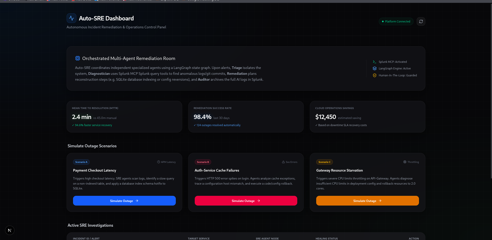
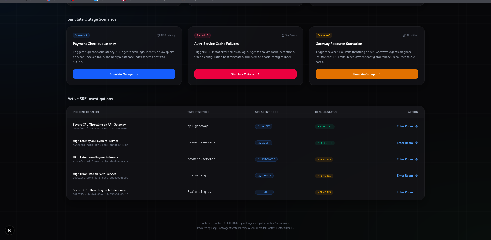
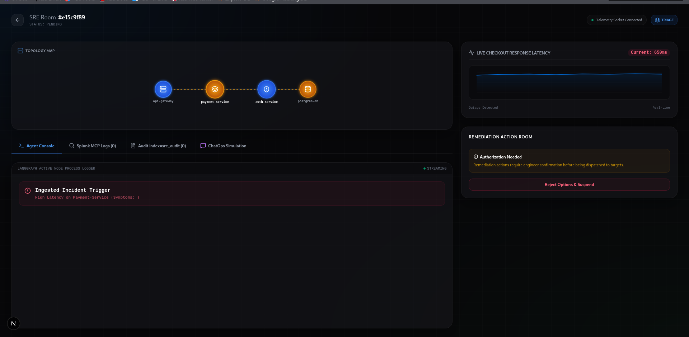
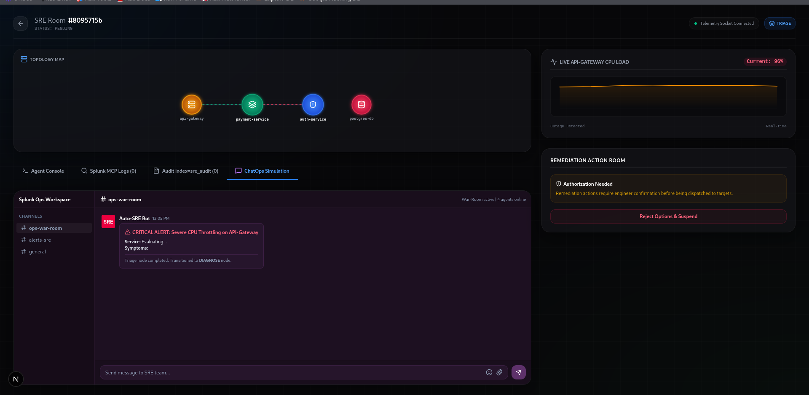
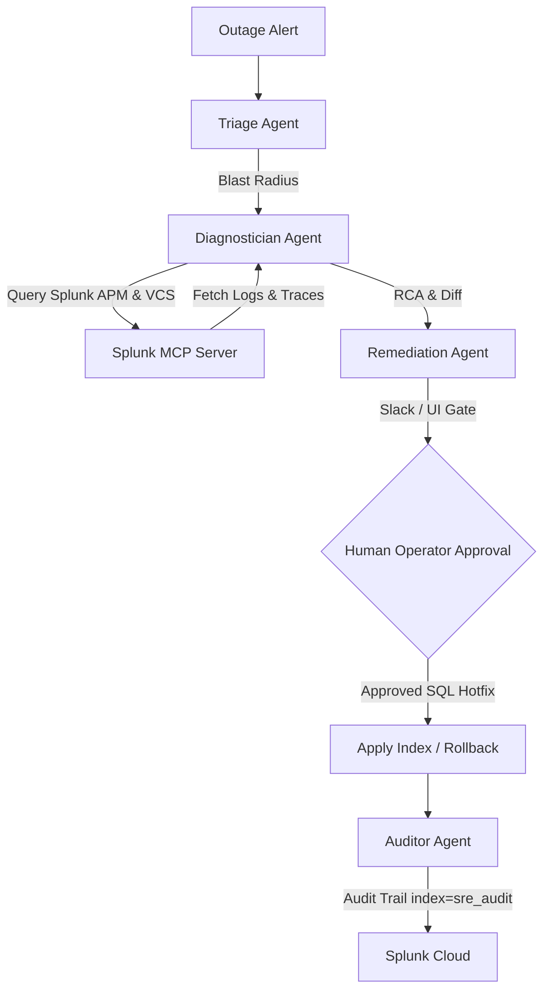

# 🚀 Auto-SRE: Autonomous Multi-Agent Incident Response & Self-Healing

Auto-SRE is an enterprise-grade, autonomous Site Reliability Engineering (SRE) assistant that automatically triages, diagnoses, and remediates application degradations in minutes instead of hours. Built for the **Splunk Agentic Ops Hackathon 2026**.

This platform integrates with **Splunk Model Context Protocol (MCP)** to query application telemetry, traces, and git VCS changes. It uses a **LangGraph State Machine** to coordinate specialized agents, request Human-In-The-Loop approvals, execute DDL schema migrations, perform config rollbacks, and record full audit traces back into Splunk.

---

## 🎨 System Walkthrough & Screenshots

### ⏱️ Side-by-Side Comparison (Manual vs. Auto-SRE)

| Step | Manual Investigation (45 - 60 Mins) | Auto-SRE Investigation (2 Mins) |
| :--- | :--- | :--- |
| **Triage** | Scroll Slack alerts, find the target microservice, set up a war room. | **Triage Agent** intercepts the alert, maps the service and symptoms in 5 seconds. |
| **APM / Logs Scan** | Run multiple manual queries on Splunk to check CPU, APM traces, and DB calls. | **Diagnostician Agent** calls Splunk MCP tools to run secure SPL queries automatically. |
| **VCS Correlation** | Scroll through git history, contact engineers to find recent config changes. | Agent inspects Splunk VCS logs, detects the faulty commit, and outputs a visual **Git Diff**. |
| **Mitigation** | Manually execute Kubernetes rollbacks or apply DDL index scripts. | **Remediation Agent** proposes recovery paths (e.g. safe SQLite Index vs. Git Rollback) instantly. |

---

### 🖥️ 1. Apple-style SRE Control Dashboard (Overview)
A sleek, glassmorphic overview displaying system health, latency metrics, mean time to resolution (MTTR) stats, and active incident rooms.


### 📊 2. Active SRE Incident Investigations Tracker
Displays multiple triggered and resolved incidents in a live, real-time status table showing active agent nodes.


### ⚙️ 3. Active Incident Room & Latency Topology
An interactive workspace displaying real-time agent console logs, SVG network topologies, and live checkout response latency charts.


### 💬 4. ChatOps Slack Integration & CPU Throttling
A live war-room simulation displaying ChatOps notifications from Auto-SRE Bot, alongside current API Gateway CPU loads and HITL authorization options.



---

## 🔄 How It Works



---

## ⚙️ How to Install & Run Locally

### 1. Prerequisites
- **Python**: Version 3.10 or higher
- **Node.js**: Version 18.x or higher
- **Ollama** (Optional for offline local reasoning): Ensure Ollama is installed and running with the model:
  ```bash
  ollama run qwen2.5-coder:1.5b
  ```

### 2. Clone and Setup Environment

#### Backend Setup:
1. Navigate to the backend directory:
   ```bash
   cd backend
   ```
2. Create and activate a virtual environment:
   ```bash
   python3 -m venv venv
   source venv/bin/activate
   ```
3. Install dependencies:
   ```bash
   pip install -r requirements.txt
   ```
4. Set up environment keys (Optional - if missing, Auto-SRE automatically falls back to Ollama or a structured reasoning simulator):
   ```bash
   export GEMINI_API_KEY="your-gemini-key"
   ```

#### Frontend Setup:
1. Navigate to the frontend directory:
   ```bash
   cd frontend
   ```
2. Install npm packages:
   ```bash
   npm install
   ```

---

### 3. Run the Platform
From the root of the project, launch the backend and frontend concurrently using the startup script:
```bash
./run.sh
```

- **Local Control Panel UI:** `http://localhost:3000`
- **FastAPI Server Endpoint:** `http://localhost:8000`

---

## 🔮 Interactive Outage Scenarios
Open the dashboard UI to trigger and resolve simulated incidents:
- **Scenario A (Payment-Service Checkout Latency):** Diagnoses a slow database transaction on the SQLite database, creating a real index schema hotfix to decrease response latency.
- **Scenario B (Auth-Service Cache Failures):** Identifies a configuration hostname mismatch in `config/production.json` and performs a Git commit rollback to heal the connection.
- **Scenario C (Gateway CPU Resource Starvation):** Detects container resource limit throttling in `gateway-deployment.yaml` and executes an automated manifest rollback restoring gateway cores.

---

## 🔗 Project Showcase Link
> **Hackathon Presentation link:** *(User link placeholder - will be added here)*
